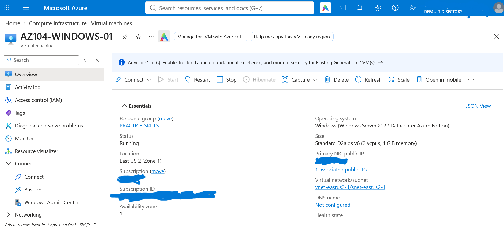
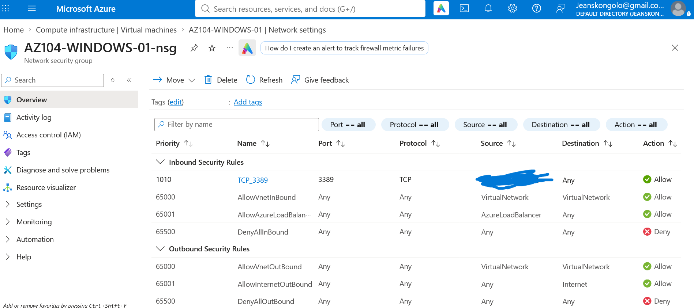

# Azure Virtual Machine Deployment & Administration

## Project Overview
This hands-on Azure Administrator project documents the deployment, configuration, security, and troubleshooting of a Windows virtual machine in Microsoft Azure.

## Technologies Used
- Microsoft Azure Portal
- Azure Virtual Machines
- Azure Resource Groups
- Azure Network Security Groups (NSGs)
- Remote Desktop Protocol (RDP)
- Windows PowerShell

## Lab Environment

| Component | Configuration |
|---|---|
| Resource Group | RG-AZ104-LAB |
| Azure Region | East US 2 |
| Virtual Machine | Windows VM |
| VM Size | Standard_B2s |
| Remote Access | RDP |

## Hands-on Implementation

### 1. Azure VM Deployment
- Created Azure resource group RG-AZ104-LAB.
- Deployed a Windows virtual machine.
- Resolved VM image security compatibility issues.
- Selected an available VM size.
- 
## Azure VM Deployment Screenshot

This screenshot shows my Windows Server 2022 virtual machine running in Microsoft Azure.

### 2. Azure Networking and Security
- Configured Network Security Group rules.
- Restricted RDP access to an authorized source IP.
- Verified successful Remote Desktop connectivity.

### 3. Windows Administration
- Connected to the Azure Windows VM.
- Used PowerShell for administration.
- Investigated Windows services and processes.
- Checked network connectivity and RDP service information.

## Troubleshooting Experience
- VM image and security type compatibility
- VM size availability restrictions
- RDP connection troubleshooting
- Windows Remote Desktop Services investigation
- Network connectivity verification
## Azure Network Security Group Configuration

Configured an Azure Network Security Group (NSG)
to secure remote access to a Windows Server 2022 VM.

### Security Configuration
- RDP Protocol: TCP
- RDP Port: 3389
- Rule Priority: 1010
- Source: Restricted to one authorized IP address
- Default inbound policy: Deny

### Screenshot

## Skills Demonstrated
Azure Administration | Virtual Machines | Azure Networking | Network Security Groups | PowerShell | Windows Administration | Troubleshooting

## Next Steps
- Add sanitized lab screenshots.
- Document verified PowerShell commands.
- Continue AZ-104 hands-on experiance.
- Expand the project with Azure monitoring and automation.

## Security
This repository is intended to contain no passwords, credentials, private keys, or sensitive connection details.

## 4. Azure Network Routing and Troubleshooting

### Project Objective
Implemented and validated custom network routing in Microsoft Azure using User Defined Routes (UDRs), subnet associations, and Azure Network Watcher.

### Lab Environment

| Component | Configuration |
|---|---|
| Azure Region | East US 2 |
| Resource Group | Practice-skills |
| Virtual Machine | AZ104-WINDOWS-01 |
| Virtual Network | vnet-eastus2-1 |
| Subnet | snet-eastus2-1 |
| Subnet Address Range | 172.16.0.0/24 |
| Route Table | RT-AZ104-LAB |

### Hands-on Implementation

- Inspected Azure default system routes.
- Analyzed longest prefix match routing behavior.
- Created and deployed a custom Azure route table.
- Configured a User Defined Route (UDR).
- Associated the route table with an existing subnet.
- Verified active routes through the network interface.
- Performed network diagnostics using Azure Network Watcher.
- Dissociated the subnet and removed the test route table.

### Custom Route Configuration

| Parameter | Value |
|---|---|
| Route Name | Block-Test-Network |
| Destination | 192.0.2.0/24 |
| Next Hop Type | None |
| Route State | Active |

### Network Watcher Diagnostic Results

| Test Parameter | Result |
|---|---|
| Source IP | 172.16.0.4 |
| Destination IP | 192.0.2.10 |
| Next Hop Type | None |
| Diagnostic Status | Successful |

The diagnostic confirmed that Azure selected the custom route to drop traffic destined for the reserved test network.

### Skills Demonstrated

- Azure Network Administration
- Azure Route Tables
- User Defined Routes (UDR)
- Virtual Networks and Subnets
- CIDR Addressing
- Longest Prefix Match
- Effective Route Analysis
- Azure Network Watcher
- Network Troubleshooting
- Azure Resource Lifecycle Management

### Project Outcome

Successfully implemented, validated, and removed a custom Azure routing configuration in a hands-on lab environment, demonstrating practical network administration and troubleshooting skills aligned with AZ-104.
